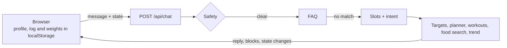

# *Ironplate*


</div>

Ironplate turns plain messages into calorie targets, full-day meal plans, weekly workouts, food logs and weight-trend analysis. It runs entirely on its own models and data, with no outside chat service and no API keys.

## What is inside

| Part | How it works |
| --- | --- |
| Intent model | TF-IDF on word and character n-grams into logistic regression, trained at build time. Cross-validation is grouped so variants of one phrase never sit in both train and test. |
| Slot extraction | Rules for age, sex, height, weight, goal, diet, allergens and units (kg/lb, cm/ft-in). Missing details are asked for, then the original request resumes. |
| Food search | Character n-gram index plus alias matching, so typos and plurals still resolve. A portion parser turns "2 rotis and a bowl of dal" into grams. |
| Meal planner | A mixed-integer program (SciPy HiGHS) chooses foods and portions to hit calories and macros within diet, allergy and dislike limits. About one second per day. |
| Workout generator | Picks a split from training days, then fills each day by movement pattern, equipment and level. |
| Progress model | Theil-Sen weekly rate, time-aware moving average, goal ETA, and an adaptive maintenance estimate from logged intake and weight. |
| Guard rails | FAQ retrieval for common questions. Emergencies, self-harm and eating-disorder language never get targets. Calorie floors, no deficits when underweight, adults only. |



The server is stateless: the page keeps everything in the browser and sends it with each message.

## Run locally

```bash
python -m venv .venv && source .venv/bin/activate
pip install -r requirements.txt
python train.py                 # trains the intent model (also runs on first start if missing)
uvicorn app.main:app --reload
```

Open <http://localhost:8000>.

## Deploy on Render

Push the repository to GitHub and create a Blueprint from `render.yaml`. The build installs the requirements and trains the model, and the free plan is enough.

## API

| Method | Path | Purpose |
| --- | --- | --- |
| POST | `/api/chat` | Message and browser state in, reply, blocks and state changes out |
| GET | `/api/foods?q=` | Fuzzy food search |
| GET | `/api/model` | Training metrics written by `train.py` |
| GET | `/health` | Status |

## Layout

```
app/        FastAPI app, dialogue, models, planner, trend
data/       foods.csv, exercises.csv, intents.json, faq.json
static/     index.html, style.css, script.js
tests/      pytest suite (pip install -r requirements-dev.txt && pytest)
train.py    trains the intent model
render.yaml Render blueprint
```

## Notes

Food values are approximate per-100 g reference figures for everyday foods. Targets are estimates for healthy adults and are not medical advice.

## License

MIT, see [LICENSE](LICENSE).

<div align="center">

[](https://github.com/AbhishekGrover1)
[](https://www.linkedin.com/in/abhishek-grover-07)
[](https://www.instagram.com/abh1shekgrover)

AI ML Engineer Abhishek Grover

</div>
